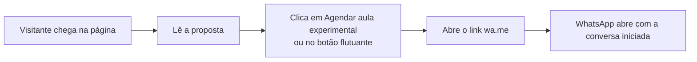
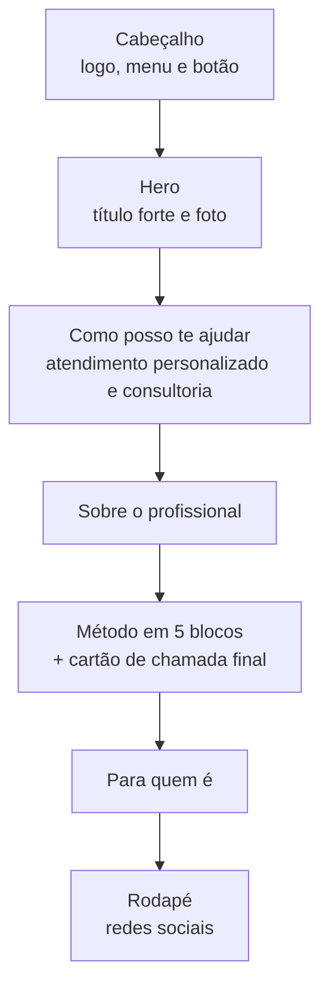
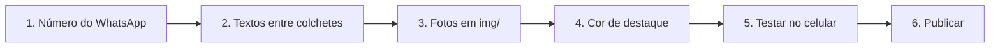

# Landing Page Personal Trainer 

Landing page simples e direta para personal trainers, feita em **HTML e CSS puros**: sem framework, sem build, sem JavaScript e sem dependências. Abre direto no navegador e publica em qualquer hospedagem estática, como a Vercel, que usamos como exemplo pra esse repositório.

Foi pensada como **modelo de venda**: o cliente troca textos, fotos, cor e o número do WhatsApp, e o site está no ar.

**Demonstração:** `(https://personaltrainer-chi.vercel.app/)`
> Existe também a [Versão 2](https://github.com/allancorreaz/personalLP2), mais completa, em outro repositório.

---

## Destaques

- Página de captação em 5 seções, rápida de personalizar
- Tema escuro com cor de destaque configurável
- Menu no topo e botão flutuante de WhatsApp sempre visível
- Responsivo (celular, tablet e desktop)
- Sem JavaScript: leve e simples de manter

## Sumário

1. [Como funciona](#como-funciona)
2. [Estrutura do projeto](#estrutura-do-projeto)
3. [Fluxo de seções](#fluxo-de-seções)
4. [Como personalizar](#como-personalizar)
5. [Como publicar na Vercel](#como-publicar-na-vercel)
6. [Compatibilidade](#compatibilidade-e-boas-práticas)
7. [Conteúdo e direitos](#conteúdo-e-direitos)

---

## Como funciona

O objetivo da página é levar o visitante a **uma única ação**: chamar o personal no WhatsApp.



Os links de WhatsApp estão escritos diretamente no `index.html` (`https://wa.me/5500000000000`), então a troca do número é feita com *Localizar e Substituir*.

---

## Estrutura do projeto

```text
.
├── index.html        # textos, seções e ícones
├── css/
│   └── style.css     # visual e regras de responsivo
├── img/              # fotos do cliente
└── README.md
```

---

## Fluxo de seções



---

## Como personalizar



### 1. WhatsApp

No editor, use *Localizar e Substituir* (`Ctrl+H`) e troque `5500000000000` pelo número real, com DDI + DDD + número, só dígitos (ex.: `5567999999999`).

### 2. Textos

Tudo o que está entre `[COLCHETES]` deve ser substituído:

| Marcador | O que colocar |
|---|---|
| `[SEU NOME]` | Nome do profissional |
| `[SUA CIDADE]` | Cidade de atendimento |
| `[SUA FOTO ...]` | Espaços de foto (veja o passo 3) |
| `[SUA HISTÓRIA]`, `[SUAS FORMAÇÕES E CERTIFICAÇÕES]` | Texto da seção "Sobre", incluindo o CREF |
| `[SUA AVALIAÇÃO ...]` | Descrição da avaliação usada no método |
| `[SUA SIGLA]` | Sigla ou nome do seu método (ex.: "Método XY") |

> **Dica:** pesquise por `[` no editor para achar tudo o que falta trocar.

### 3. Fotos

Coloque as imagens (de preferência `.webp`, até ~300 KB cada) na pasta `img/` e troque cada espaço de foto por uma tag de imagem:

```html

```

### 4. Cor de destaque

No `index.html`, procure a linha abaixo e troque o valor pela cor do cliente:

```html
<div class="lp" style="--accent:#FF5A1F; width:100%">
```

Algumas sugestões: turquesa `#2DD4BF`, roxo `#A78BFA`, amarelo `#FACC15`. As demais cores ficam em `css/style.css`.

### 5. Testar

Abra o `index.html` no navegador e confira no celular: número do WhatsApp, textos e links do rodapé (Instagram e Facebook).

---

## Como publicar na Vercel

Como o projeto já está na raiz do repositório, não é preciso configurar nada de especial.

1. Acesse [vercel.com/new](https://vercel.com/new) e importe este repositório.
2. Em **Framework Preset**, deixe **Other**. Não há *Build Command* nem *Output Directory*.
3. Clique em **Deploy**.

Cada novo `git push` na branch principal atualiza o site. Para usar o domínio do cliente, vá em *Settings → Domains*.

---

## Compatibilidade e boas práticas

- **Navegadores:** versões atuais de Chrome, Edge, Firefox e Safari.
- **Fontes:** Barlow Condensed e DM Sans, carregadas do Google Fonts (a página precisa de internet na primeira visita).
- **Desempenho:** sem JavaScript e sem bibliotecas. O que mais pesa são as fotos, então otimize-as antes de subir.
- **SEO básico:** ajuste o `<title>` e adicione uma `<meta name="description">` com o nome e a cidade do cliente.

---

## Conteúdo e direitos

- Os **textos são modelos genéricos** e devem ser adaptados à voz e aos serviços de cada profissional.
- **Fotos, nome, CREF e qualquer depoimento** pertencem ao cliente. Use somente material dele e com autorização.
- O layout é uma criação própria, sem uso de textos, imagens ou marcas de terceiros.
